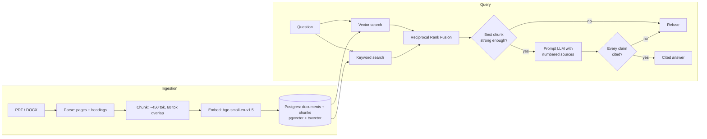

# Cited Document Q&A (RAG)

Ask questions about a set of uploaded documents and get an answer that cites
the exact page it came from — or a plain refusal when the documents don't
cover the question.

## The problem

Research, legislation and industry guidance exist to answer most workplace
questions, but reading through a stack of PDFs to find the right page is
slow, and a generic chatbot will happily answer from memory instead of from
the actual source — with no way to check it. This service answers only from
documents you give it, and every claim is traceable back to a page.

## Architecture

One Python service, one PostgreSQL database (pgvector + full-text search for
hybrid retrieval), and a pluggable LLM behind one interface — Ollama locally
by default, Claude or OpenAI via config.



The system can refuse at two points: before the LLM, when retrieval finds
nothing strong, and after it, when the answer carries no valid citations.

| Layer | Choice | Why |
| --- | --- | --- |
| Parsing | PyMuPDF (PDF), python-docx (DOCX) | Keeps page numbers for citations |
| Embeddings | `BAAI/bge-small-en-v1.5` (384 dims) | Free, CPU-sized, strong for its size |
| Store + search | PostgreSQL 16 + pgvector + full-text search | One database, hybrid retrieval in one SQL query |
| LLM | Ollama locally; Claude or OpenAI via config | Free dev loop, swappable provider |
| API | FastAPI + Pydantic | Typed requests, auto docs at `/docs` |
| Tests | pytest, FastAPI TestClient, a fake LLM | Deterministic, no API cost in CI |
| Packaging | Docker + docker-compose | One command to run |
| CI | GitHub Actions, Postgres service container | Tests run on every push |

## Results

Pending the first full evaluation run (`python -m eval.run`). This section
will hold measured Recall@5 / MRR@10 across retrieval modes, refusal
accuracy, and latency — every number sourced from `eval/results/*.json`,
never estimated. See `EVALUATION.md` once it exists.

## Quick start

```bash
git clone <this-repo-url>
cd cited-docs-qa
cp .env.example .env
docker compose up -d db
uv sync
uv run python -m app.ingest data/raw
uv run uvicorn app.api:app --reload
```

Then open `http://localhost:8000/docs` for the interactive API, or:

```bash
curl -X POST http://localhost:8000/ask \
  -H "Content-Type: application/json" \
  -d '{"question": "How much long service leave am I entitled to?"}'
```

```json
{
  "answer": "An employee is generally entitled to long service leave after a continuous period of service with one employer... [S1]",
  "citations": [
    {"marker": 1, "title": "Long-service-leave", "page": 1, "snippet": "..."}
  ],
  "refused": false,
  "timings_ms": {"retrieve": 42.1, "generate": 980.4, "total": 1022.5},
  "model": "llama3.1:8b"
}
```

## Running tests

```bash
docker compose up -d db
uv run pytest
```

## Design decisions

- **One database for both searches.** pgvector and PostgreSQL's built-in
  full-text search live in the same table, so hybrid retrieval is a single
  SQL query per signal and there's no second system to run or keep in sync.
- **Reciprocal Rank Fusion, not score blending.** Cosine distance and
  text-rank scores aren't comparable; RRF fuses by rank instead, so it never
  needs score normalization.
- **Refuse twice.** Once before the LLM runs (weak retrieval), once after
  (an answer with no valid citation is treated as unsupported) — a model
  that occasionally forgets to cite can't silently produce an unchecked claim.
- **Pluggable LLM, free by default.** Development and CI run entirely on a
  local Ollama model; switching to Claude or OpenAI is a config change, not a
  code change.

## Limitations

- The evaluation set (`eval/questions.jsonl`) is hand-written by the project
  author from the same documents the system indexes — it is not an
  independent, blind test set.
- Answer correctness and faithfulness are hand-scored on a sample, not fully
  automated; see `EVALUATION.md` for the sample size and method.
- Covers one domain (Australian workplace guidance) and one small local
  model by default — results may not generalize to other domains or to
  larger hosted models without re-running the evaluation.
- "Guidance only" applies to the underlying source documents too: this is a
  portfolio demo, not legal advice.

## Data sources and licensing

The code in this repository is MIT licensed (see `LICENSE`). The documents
under `data/raw/` are Fair Work Ombudsman fact sheets, © Commonwealth of
Australia, used under CC BY-NC 4.0 — see `data/raw/SOURCES.md` for the full
list, licence terms and per-file source URLs.
